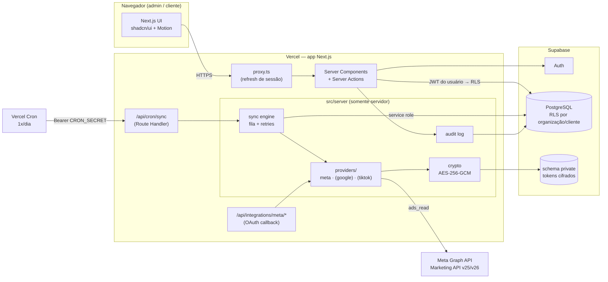

# Arquitetura — WRMax Metrics

> Plataforma SaaS multi-organização para acompanhamento de métricas de tráfego pago.
> Primeira integração: Meta Ads (Marketing API oficial). Atualização automática a cada 24 h.

Status do documento: **Fase 1 (descoberta e planejamento)**, outubro de 2026.
Decisões individuais estão registradas em [`docs/adr/`](./adr).

---

## 1. Visão geral

Um **monólito modular em Next.js** (App Router) hospedado na Vercel, com **Supabase**
(PostgreSQL + Auth + RLS) como banco e provedor de identidade. A coleta de dados roda
**no servidor**, disparada por **Vercel Cron**, totalmente independente de sessões de
usuário ou navegadores abertos.

Não há microserviços. A única peça fora do monólito, prevista para uma fase posterior e
opcional, é o **renderizador de vídeos HyperFrames**, que exige Chrome headless + FFmpeg
e por isso não cabe numa função serverless comum (ver [`hyperframes.md`](./hyperframes.md)).



### Fluxo de dados (coleta → exibição)

1. **Conexão** — um administrador da agência conecta o Meta via _Facebook Login for
   Business_ (`config_id`). O `code` é trocado no servidor por um token; o token é
   **cifrado (AES-256-GCM)** e gravado no schema `private`, que não é exposto pela API
   do Supabase. O navegador nunca vê o token.
2. **Seleção de contas** — o admin escolhe quais contas de anúncio (`act_…`) entram na
   sincronização e associa cada uma a um **cliente**.
3. **Agendamento** — a Vercel Cron chama `GET /api/cron/sync` uma vez por dia, com
   `Authorization: Bearer $CRON_SECRET`.
4. **Enfileiramento** — o handler cria um `sync_run` e um `sync_job` por conta ativa
   (idempotente: uma conta não recebe dois jobs para a mesma janela).
5. **Processamento** — cada job, dentro de um orçamento de tempo:
   - obtém o token (decifra em memória);
   - atualiza o cadastro de campanhas;
   - busca _insights_ diários por campanha dos **últimos 28 dias** (janela de
     reprocessamento: a Meta afirma que os dados param de mudar após 28 dias);
   - busca **alcance deduplicado** para os períodos-padrão (ver §6 do modelo de dados);
   - faz `UPSERT` por chave natural (`campaign_id, date, attribution_setting`) —
     reexecuções não duplicam linhas.
6. **Registro** — início, fim, contagem de linhas, código de erro (sanitizado) e
   próxima tentativa ficam em `sync_jobs` / `sync_events`. Falhas **não apagam** os
   últimos dados válidos; apenas `ad_account_sync_state.last_success_at` deixa de avançar.
7. **Retentativas** — erros transitórios (rate limit, 5xx, timeout) recebem backoff
   exponencial com teto de tentativas; erros de autenticação marcam a conexão como
   `needs_reauth` e geram alerta no painel admin.
8. **Leitura** — Server Components consultam o banco **com o JWT do usuário**, então a
   RLS do PostgreSQL filtra os dados por organização/cliente mesmo que a camada de
   aplicação falhe. Métricas derivadas (CTR, CPC, CPM…) são calculadas a partir de
   somas de componentes, nunca somando taxas.

---

## 2. Escolhas tecnológicas

| Camada         | Escolha                                          | Por quê                                                                                                                         | Custo                  | Alternativas descartadas                                                   |
| -------------- | ------------------------------------------------ | ------------------------------------------------------------------------------------------------------------------------------- | ---------------------- | -------------------------------------------------------------------------- |
| App web        | **Next.js 16.4** (App Router, React 19.3)        | Server Components reduzem JS no cliente; Route Handlers servem cron e OAuth no mesmo deploy; ecossistema do shadcn/ui é nativo. | Open source            | Vite SPA + API separada (dois deploys, auth duplicada)                     |
| Linguagem      | **TypeScript** estrito                           | Tipos gerados do schema do Supabase propagam até a UI.                                                                          | —                      | —                                                                          |
| Estilo         | **Tailwind CSS 4.3**                             | Tokens em CSS (`@theme`), requisito do shadcn/ui atual.                                                                         | —                      | CSS Modules (sem integração com shadcn)                                    |
| Componentes    | **shadcn/ui** (CLI 4.x, Radix)                   | Código copiado para o repo → personalização total, sem lock-in de versão.                                                       | —                      | MUI/Chakra (visual genérico, difícil de refinar)                           |
| Ícones         | **lucide-react**                                 | Padrão do shadcn/ui, traço consistente.                                                                                         | —                      | —                                                                          |
| Animação UI    | **Motion for React** (`motion`)                  | Layout animations, `AnimatePresence`, springs, `MotionConfig reducedMotion="user"`.                                             | —                      | GSAP (licença/peso para UI), CSS puro (sem exit animations)                |
| Gráficos       | **Recharts 3** via `chart` do shadcn/ui          | Componente oficial do shadcn, tematizável por CSS vars.                                                                         | —                      | ECharts (bundle maior, visual destoante)                                   |
| Tabelas        | **TanStack Table** (padrão data-table do shadcn) | Ordenação/filtros headless.                                                                                                     | —                      | AG Grid (peso, licença)                                                    |
| Validação      | **Zod 4**                                        | Valida entradas de Server Actions e respostas da Meta.                                                                          | —                      | —                                                                          |
| Banco          | **PostgreSQL (Supabase)**                        | Relacional, RLS nativa, `pg_cron` disponível se necessário.                                                                     | Free → Pro US$ 25/mês  | Neon + Auth.js (mais peças para integrar)                                  |
| Auth           | **Supabase Auth** (`@supabase/ssr`)              | Sessão em cookies, JWT usado diretamente pela RLS.                                                                              | Incluso                | Clerk (custo por MAU, JWT externo à RLS)                                   |
| Acesso a dados | **supabase-js + tipos gerados**                  | Mantém o JWT do usuário em cada consulta → RLS sempre ativa.                                                                    | —                      | Drizzle/Prisma com conexão direta (bypassa RLS por padrão)                 |
| Agendador      | **Vercel Cron** → Route Handler                  | Zero infraestrutura extra; funciona no plano Hobby (1x/dia, precisão ±59 min).                                                  | Incluso                | Inngest/Trigger.dev (ótimos, mas mais um fornecedor — caminho de evolução) |
| Hospedagem     | **Vercel**                                       | Deploy nativo do Next.js, cron integrado, conector disponível neste ambiente.                                                   | Hobby → Pro US$ 20/mês | Fly/Render (exigem mais operação)                                          |
| Testes         | **Vitest** (unit/integração)                     | Rápidos, padrão de mercado. Playwright (E2E) foi removido a pedido; telas são validadas no navegador.                           | —                      | Jest (mais lento com ESM)                                                  |
| Versionamento  | **Git + GitHub**                                 | Revisão via PR, CI com GitHub Actions.                                                                                          | —                      | —                                                                          |

### Limites conhecidos que influenciam o desenho

- **Vercel Hobby**: cron no máximo 1x/dia e sem horário exato; funções com duração
  máxima limitada. Por isso o motor de sync usa **fila em tabela + orçamento de tempo**:
  se uma execução não termina todas as contas, os jobs pendentes continuam na próxima
  chamada (manual ou agendada). No plano Pro, adiciona-se um segundo cron de "drenagem"
  a cada 15 min para retentativas — sem mudar código.
- **Meta, acesso limitado (dev)**: limites de requisição baixos; suficiente para
  desenvolvimento com as contas da própria agência. Para atender contas de **outras
  empresas** é preciso _Advanced Access_ em `ads_read` (App Review) e _Full access_ no
  Marketing API Access Tier (≥ 500 chamadas bem-sucedidas em 15 dias, < 15% de erro).
  Ver [`meta-integration.md`](./meta-integration.md).

---

## 3. Multi-organização e isolamento

- Toda linha de dado de negócio carrega `organization_id` (e `client_id` quando
  aplicável) **desnormalizado**, para que as políticas RLS sejam simples e indexáveis.
- Papéis (`membership_role`): `owner`, `admin`, `analyst` (equipe da agência) e
  `client_viewer` (usuário do cliente final, com escopo restrito a `client_members`).
- Verificação em **três camadas**:
  1. _proxy_ apenas renova a sessão e redireciona anônimos (nunca é a única barreira);
  2. **DAL** (`src/server/auth`) — cada Server Component/Action verifica sessão e papel;
  3. **RLS** no PostgreSQL — a barreira final; IDs vindos da URL nunca bastam.
- Tokens da Meta ficam em `private.platform_credentials`, acessível somente pela
  _service role_ dentro de `src/server/**` (módulo marcado com `import "server-only"`).
- Ações administrativas geram entradas em `audit_logs` (append-only via RLS).

---

## 4. Estrutura de pastas

```
wrmax-metrics/
├─ docs/                         # arquitetura, ADRs, modelo de dados, integrações, deploy
├─ supabase/
│  ├─ migrations/                # SQL versionado (timestamp_nome.sql)
│  ├─ seed.sql                   # dados SIMULADOS para desenvolvimento
│  └─ tests/                     # testes de RLS (isolamento entre organizações)
├─ src/
│  ├─ app/
│  │  ├─ (auth)/login/           # login, recuperação de senha
│  │  ├─ (app)/                  # área autenticada (sidebar)
│  │  │  ├─ dashboard/           # visão geral do cliente selecionado
│  │  │  ├─ campaigns/           # tabela de campanhas + detalhe
│  │  │  └─ admin/               # organizações, clientes, contas, integrações,
│  │  │                          # sincronizações, acessos, auditoria
│  │  └─ api/
│  │     ├─ cron/sync/           # disparado pela Vercel Cron
│  │     └─ integrations/meta/   # início e callback do OAuth
│  ├─ components/
│  │  ├─ ui/                     # primitivas shadcn/ui (personalizadas)
│  │  ├─ layout/                 # sidebar, topbar, page header
│  │  ├─ metrics/                # KPI cards, deltas, número animado
│  │  ├─ charts/                 # séries temporais
│  │  ├─ tables/                 # data tables
│  │  ├─ feedback/               # empty states, skeletons, erros, badge "SIMULADO"
│  │  └─ motion/                 # presets de animação reutilizáveis
│  ├─ lib/                       # código isomórfico: formatação, datas, métricas puras
│  │  ├─ metrics/                # definições e cálculo de métricas derivadas
│  │  └─ supabase/               # clients browser/server
│  └─ server/                    # SOMENTE servidor (`server-only`)
│     ├─ auth/                   # DAL: getSession, requireRole, requireClientAccess
│     ├─ db/                     # tipos gerados + repositórios
│     ├─ crypto/                 # cifragem de tokens
│     ├─ integrations/
│     │  ├─ core/                # interface AdPlatformProvider, erros normalizados
│     │  └─ meta/                # cliente Graph API, mapeamento, OAuth
│     ├─ sync/                   # orquestração, fila, retries, idempotência
│     └─ audit/
├─ tests/
│  ├─ unit/                      # Vitest
│  └─ integration/               # Vitest + banco
└─ video-reports/                # (fase futura, isolado) projeto HyperFrames
```

---

## 5. Pontos em aberto (a validar nas fases indicadas)

| Tema                                                                                           | Fase | Como validar                                                                   |
| ---------------------------------------------------------------------------------------------- | ---- | ------------------------------------------------------------------------------ |
| Campo de "resultados" da Meta (`results`/`cost_per_result` vs. `actions` + meta de otimização) | 6    | Consulta autorizada real + comparação com o Gerenciador de Anúncios            |
| Mudanças da v26 que passam a valer em todas as versões                                         | 6    | Changelog oficial da Meta antes de fixar a versão                              |
| Duração máxima de função no plano escolhido da Vercel                                          | 7/9  | Teste de carga do sync com N contas                                            |
| Projeto Supabase (hospedado) e chaves                                                          | 5    | Usuário cria o projeto; sem Docker local, migrações vão para um projeto de dev |
| Testes de RLS sem Docker                                                                       | 5    | Avaliar PGlite (Postgres em WASM) com _shim_ de `auth.uid()`                   |
