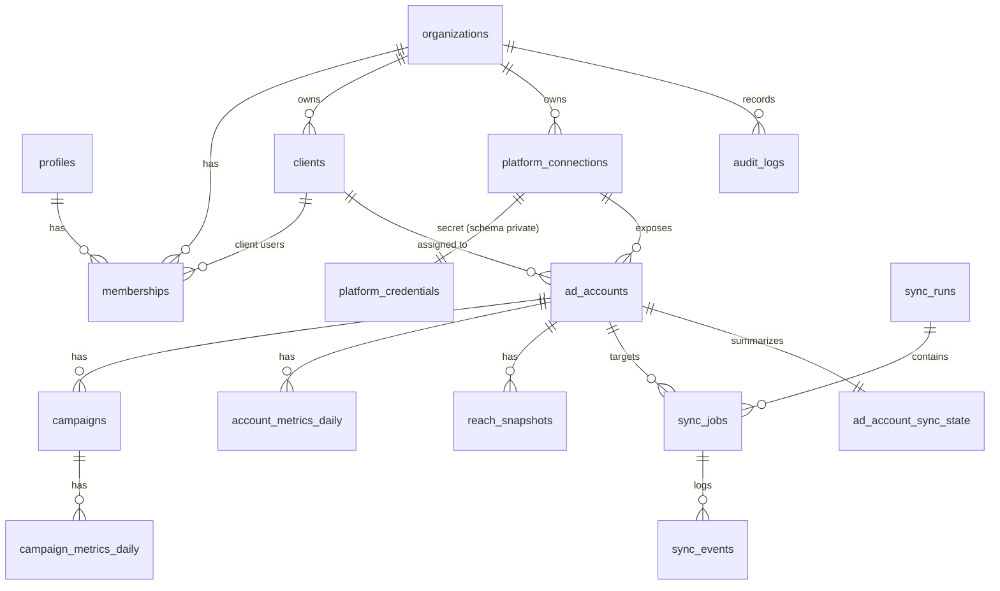

# Modelo de dados

PostgreSQL (Supabase). Migrações versionadas em `supabase/migrations/`.
Este documento é o desenho da Fase 1; a implementação ocorre na Fase 5 e pode
refinar nomes, mas não os princípios.

## Princípios

1. **Granularidade base: campanha × dia** (data local do fuso da conta de anúncios).
   Níveis conjunto/anúncio ficam para depois do MVP; o esquema comporta a extensão.
2. **Guardar componentes, derivar taxas.** Persistimos `spend`, `impressions`,
   `inline_link_clicks`, `results`… e calculamos CTR/CPC/CPM/custo por resultado na
   consulta, a partir das **somas** do período. Nunca se soma ou se faz média de taxas.
3. **Ausente ≠ zero.** Colunas de métrica são `NULL` quando a API não retornou o campo
   (ex.: campanha sem evento de conversão). A UI mostra "—" com explicação, não "0".
4. **Alcance não é aditivo.** O alcance de um período **não** é a soma dos alcances
   diários (a mesma pessoa conta em vários dias). Ver §6.
5. **Moeda e fuso pertencem à conta.** Valores monetários ficam na moeda da conta
   (`numeric(18,4)`), sem conversão. Agregações misturando moedas são bloqueadas.
6. **Proveniência.** Cada linha de métrica guarda `source`, `api_version`,
   `attribution_setting`, `synced_at` e `sync_job_id`.
7. **Idempotência.** Chaves naturais únicas + `INSERT … ON CONFLICT DO UPDATE`.
8. **Isolamento.** `organization_id` (e `client_id`) desnormalizados em todas as
   tabelas de negócio; RLS habilitada em todas.

## Diagrama

## Tabelas

### Identidade e acesso

| Tabela          | Colunas principais                                                                                                         | Observações                                                                                                                           |
| --------------- | -------------------------------------------------------------------------------------------------------------------------- | ------------------------------------------------------------------------------------------------------------------------------------- |
| `organizations` | `id uuid pk`, `name`, `slug unique`, `default_timezone`, `created_at`                                                      | A agência (tenant).                                                                                                                   |
| `profiles`      | `id uuid pk = auth.users.id`, `full_name`, `avatar_url`, `is_platform_admin bool`                                          | Criado por trigger no signup. `is_platform_admin` só via service role.                                                                |
| `memberships`   | `organization_id`, `user_id`, `role membership_role`, `client_id null fk`, `created_at`; **pk (organization_id, user_id)** | `membership_role`: `admin` (agência) ou `client`. **check**: `client` exige `client_id`; `admin` exige `client_id is null` (ADR-009). |
| `clients`       | `id`, `organization_id fk`, `name`, `status (active/archived)`, `created_at`                                               | Cliente final da agência. Índice `(organization_id)`.                                                                                 |

### Integrações

| Tabela                         | Colunas principais                                                                                                                                                                                                                                                                        | Observações                                                                                                                            |
| ------------------------------ | ----------------------------------------------------------------------------------------------------------------------------------------------------------------------------------------------------------------------------------------------------------------------------------------- | -------------------------------------------------------------------------------------------------------------------------------------- |
| `platform_connections`         | `id`, `organization_id`, `platform ad_platform` (`meta`, futuro `google_ads`, `tiktok_ads`), `external_user_or_business_id`, `token_type` (`user`/`system_user`), `scopes text[]`, `status` (`active`/`needs_reauth`/`revoked`/`error`), `expires_at`, `last_validated_at`, `created_by`  | Metadados visíveis a admins. **Sem segredo.**                                                                                          |
| `private.platform_credentials` | `connection_id pk fk`, `ciphertext bytea`, `iv bytea`, `auth_tag bytea`, `key_version int`, `updated_at`                                                                                                                                                                                  | Schema `private` não exposto pelo PostgREST; sem grants para `anon`/`authenticated`. Cifrado com AES-256-GCM (`TOKEN_ENCRYPTION_KEY`). |
| `ad_accounts`                  | `id`, `organization_id`, `client_id null`, `connection_id`, `platform`, `external_id` (ex.: `act_123`), `name`, `currency char(3)`, `timezone_name`, `account_status`, `sync_enabled bool`, `attribution_setting text`, `created_at`; **unique (platform, external_id, organization_id)** | Contas sem `client_id` só aparecem para a agência.                                                                                     |
| `campaigns`                    | `id`, `organization_id`, `client_id`, `ad_account_id`, `external_id`, `name`, `objective`, `status`, `effective_status`, `buying_type`, `start_time`, `stop_time`, `external_updated_time`, `synced_at`; **unique (ad_account_id, external_id)**                                          | Atualizada a cada sync.                                                                                                                |

### Métricas

| Tabela                   | Grão                                        | Chave única                                                                                   | Colunas                                                                                                                                                                                                                                                                                                                                                          |
| ------------------------ | ------------------------------------------- | --------------------------------------------------------------------------------------------- | ---------------------------------------------------------------------------------------------------------------------------------------------------------------------------------------------------------------------------------------------------------------------------------------------------------------------------------------------------------------- |
| `campaign_metrics_daily` | campanha × dia × configuração de atribuição | `(campaign_id, date, attribution_setting)`                                                    | `organization_id`, `client_id`, `ad_account_id`, `date` (local da conta), `currency`, `spend`, `impressions`, `reach_daily` (não aditivo!), `clicks_all`, `inline_link_clicks`, `results`, `result_indicator` (ex.: `actions:offsite_conversion.fb_pixel_purchase`), `actions jsonb`, `action_values jsonb`, `source`, `api_version`, `synced_at`, `sync_job_id` |
| `account_metrics_daily`  | conta × dia                                 | `(ad_account_id, date, attribution_setting)`                                                  | mesmas colunas, nível conta (usado para totais e conferência)                                                                                                                                                                                                                                                                                                    |
| `reach_snapshots`        | conta ou campanha × período fixo            | `(ad_account_id, campaign_id nulls not distinct, date_start, date_stop, attribution_setting)` | `reach`, `impressions`, `frequency`, `fetched_at`                                                                                                                                                                                                                                                                                                                |

Índices: `(client_id, date)` e `(ad_account_id, date)` em `*_metrics_daily`;
`(organization_id)` em todas as tabelas com RLS.

### Operação e auditoria

| Tabela                  | Colunas principais                                                                                                                                                                                                                                                                                                         | Observações                                                                                                  |
| ----------------------- | -------------------------------------------------------------------------------------------------------------------------------------------------------------------------------------------------------------------------------------------------------------------------------------------------------------------------- | ------------------------------------------------------------------------------------------------------------ |
| `sync_runs`             | `id`, `trigger` (`cron`/`manual`/`retry`), `requested_by null`, `started_at`, `finished_at`, `status` (`running`/`succeeded`/`partial`/`failed`), `stats jsonb`                                                                                                                                                            | Uma execução do agendador.                                                                                   |
| `sync_jobs`             | `id`, `sync_run_id`, `organization_id`, `ad_account_id`, `window_start`, `window_end`, `status` (`queued`/`running`/`succeeded`/`failed`/`retry_scheduled`/`dead`), `attempt`, `max_attempts`, `next_attempt_at`, `locked_until`, `rows_upserted`, `error_code`, `error_message` (sanitizado), `started_at`, `finished_at` | Índice parcial em `status in ('queued','retry_scheduled')`. `locked_until` impede processamento concorrente. |
| `sync_events`           | `id`, `sync_job_id`, `level`, `message`, `context jsonb`, `created_at`                                                                                                                                                                                                                                                     | Log operacional estruturado. **Nunca** contém token ou URL com `access_token`.                               |
| `ad_account_sync_state` | `ad_account_id pk`, `last_success_at`, `data_through_date`, `last_attempt_at`, `last_error_code`, `consecutive_failures`                                                                                                                                                                                                   | Fonte do "Atualizado em …" exibido ao cliente.                                                               |
| `audit_logs`            | `id`, `organization_id`, `actor_user_id`, `action`, `target_type`, `target_id`, `metadata jsonb`, `ip inet`, `created_at`                                                                                                                                                                                                  | Append-only: RLS permite `insert` pelo servidor e `select` para admins; sem `update`/`delete`.               |

## RLS (resumo)

Funções auxiliares `security definer`, `stable`, com `search_path` fixo:

- `app.is_org_member(org uuid)` — qualquer papel na organização.
- `app.has_org_role(org uuid, roles membership_role[])`.
- `app.can_view_client(client uuid)` — `admin` da organização do cliente **ou** usuário
  `client` cuja `memberships.client_id` é esse cliente.

Políticas:

- `organizations`, `clients`, `ad_accounts`, `campaigns`, `*_metrics_*`,
  `ad_account_sync_state`: `select` se `can_view_client(client_id)`; linhas sem
  `client_id` exigem papel de agência.
- Escrita em tabelas de cadastro: `has_org_role(organization_id, {admin})`.
- Tabelas de métricas e de sync: **sem escrita** para `authenticated`; só a
  _service role_ (motor de sync) grava.
- `private.*`: sem grants para `anon`/`authenticated`.

Testes obrigatórios (Fase 5/8): usuário da organização A não lê nada da B, mesmo
passando IDs da B; usuário `client` do cliente X não lê o cliente Y da mesma agência.

## §6 — Alcance e frequência

A Meta deduplica o alcance **dentro do intervalo consultado**. Portanto:

- `reach_daily` serve apenas para o gráfico diário ("alcance do dia").
- Para os períodos-padrão do filtro (**últimos 7, 14, 30 dias, mês atual, mês
  anterior** e os períodos anteriores equivalentes para comparação), o sync grava o
  alcance deduplicado em `reach_snapshots`.
- Em **intervalos personalizados**, alcance e frequência do período aparecem como
  "indisponível para intervalo personalizado" (com tooltip explicando), em vez de uma
  soma enganosa. Evolução futura: consulta sob demanda com cache.
- Frequência = `impressions / reach` do mesmo intervalo deduplicado.
- Restrição da Meta: breakdowns com alcance têm retenção de 13 meses; frequência, 6
  meses (segundo nota de atualização de 2026 — confirmar na Fase 6).

## Definições de métricas (MVP)

| Métrica             | Fórmula / campo                                | Aditiva?      | Quando é `NULL`                            |
| ------------------- | ---------------------------------------------- | ------------- | ------------------------------------------ |
| Investimento        | `Σ spend`                                      | sim           | nunca (0 é real se a campanha não gastou)  |
| Impressões          | `Σ impressions`                                | sim           | —                                          |
| Alcance             | snapshot deduplicado                           | **não**       | intervalo personalizado / fora da retenção |
| Frequência          | `impressions / reach`                          | **não**       | quando alcance é `NULL`                    |
| Cliques no link     | `Σ inline_link_clicks`                         | sim           | campo ausente na resposta                  |
| CTR de link         | `Σ inline_link_clicks / Σ impressions × 100`   | **não**       | impressões = 0                             |
| CPC de link         | `Σ spend / Σ inline_link_clicks`               | **não**       | cliques = 0                                |
| CPM                 | `Σ spend / Σ impressions × 1000`               | **não**       | impressões = 0                             |
| Resultados          | `Σ results` (somente mesmo `result_indicator`) | sim, por tipo | campanha sem resultado definido            |
| Custo por resultado | `Σ spend / Σ results`                          | **não**       | resultados = 0 ou tipos diferentes         |

Campanhas com tipos de resultado diferentes (ex.: compras vs. leads) **não** têm seus
resultados somados num único número; a UI agrupa por tipo.

## Campos adicionados para a visão do cliente (contrato da Fase 6)

Opcionais e aditivos — ausentes significam "sem dado", nunca zero:

| Onde                            | Campo                                                                | Origem na Meta                                                  |
| ------------------------------- | -------------------------------------------------------------------- | --------------------------------------------------------------- |
| `*_metrics_daily`               | `purchase_value`                                                     | `action_values` (compras)                                       |
| `*_metrics_daily`               | `add_to_cart`, `initiate_checkout`                                   | `actions` (`add_to_cart`, `initiate_checkout`)                  |
| `clients`                       | `objective` (`purchases`/`messages`/`leads`), `cost_per_result_goal` | cadastro da agência                                             |
| nova `ad_metrics_daily` + `ads` | métricas por anúncio, `thumbnail_url`                                | Insights `level=ad` + `/{ad_id}?fields=creative{thumbnail_url}` |

ROAS = `Σ purchase_value ÷ Σ spend` (mesma definição do `purchase_roas` da Meta). Hoje esses
campos só existem no cliente de demonstração "Pizzaria Demonstração".

## Comparação com o período anterior

- O período anterior equivalente tem o **mesmo número de dias**, imediatamente antes
  (`previousPeriod`).
- Se o período selecionado vai além do último dia sincronizado (ex.: "Este mês" inclui
  hoje; ou a sincronização falhou), a comparação é **dia a dia**: os dias cobertos contra
  o mesmo número de dias do início do período anterior (`lib/dates/coverage.ts`). Sem isso,
  um período incompleto aparece como queda artificial. A UI explica o recorte.
- Resultados só são comparados quando os dois períodos têm o mesmo tipo de resultado.
